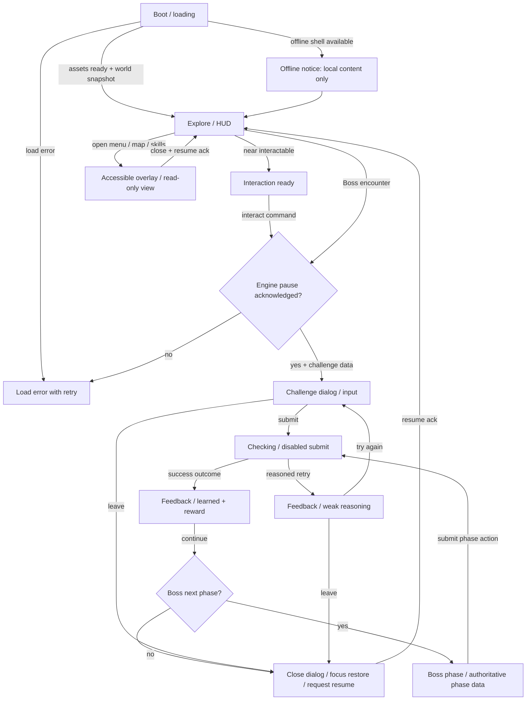

# First World UI/UX — design packet (Issue #1)

**Status:** DESIGN PROTOTYPE ONLY; not an approved visual direction or an integrated game UI.
**Baseline main SHA:** `40c76c3aafe6b8bd3d2db0723587e7d02ec9dcc1` (2026-11-08).
**Owners:** UI owns only `src/ui/` and `public/assets/ui/`. HQ owns `src/contracts/` and engine agreement.
**Approval blockers:** Game Director's world/hero/HUD direction; HQ UIBridge state/events; Engine pause/resume acknowledgment; Learning feedback and Boss event payloads.

## 2026-11-08 creative-direction reconciliation (Game Director PR #11)

**Source:** `docs/creative/W01-CREATIVE-GDD.md` and `docs/creative/W01-ART-HERO-BIBLE.md` from branch `cq/director/w01-creative-signoff-20261108`, PR #11. **Creative direction approved for prototype**, not merged into `main` and not a signed UIBridge schema.

**Correction to initial concept:** Level 01 is **Inspect two witnessed behaviors via Evidence Lens**, not primarily a free-text textbox. Our earlier text-first prototype would feel like the same old quiz, so the preview has been revised to evidence cards and explicit selection feedback. A separate text-reflection field may be required by Learning Architect later but must not gate the first interaction without learning signoff.

### W01 UI action sequence (creative intent, not runtime event names)

| Story moment | Player interface | Desired world consequence (Engine/World-owned, NOT implemented in UI) | HQ input needed |
| --- | --- | --- | --- |
| Entry to library clearing | Compact quest + grounded nearby clue, Inspect action | Lens and one reachable piece of evidence become interactable | Target IDs, proximity, Camera/ground bounds |
| L01 Inspect | DOM evidence cards representing discovered physical slips; two observed items vs one unsupported conclusion | Correctly recognized witnessed behavior illuminates first trail; unsupported assumption gets explain-why retry | evidence asset identifiers, inspection provenance, accepted pair/rubric result |
| L01 Feedback | 'إيه اللي اتشاف؟ / إيه اللي اتفسر؟ / إيه الدليل الناقص؟' | Revealed route **only if** Engine confirms encounter resolved | World effect and commit event; UI reads state |
| L02–03 | NPC evidence match / ticket order strip | Different cognitive verbs in adjacent encounters | ChallengeKind extensions/keyboard-equivalent API |
| L04–06 | Compare / deflect / route with clear uncertainty labels | Branches change in environment, not XP-only | UI choices and 3-state claim classifications |
| L07–09 | Interview / test / forge with at least two viable outcomes | Equal defensible routes and concept seed previews | Learning multiple-valid rubric, Engine navigation |
| Boss stage 1 — Fog | inspect environmental clues then select two observed details | false fog collapses, first anchor revealed | Boss phase events and clue IDs |
| Boss stage 2 — Mirror | choose **tentative hypothesis + differentiating evidence to test** | reflection/route changes; qualified alternative approaches accepted | Boss accepted pair/outcome structure |
| Boss stage 3 — Forge | combine observed behavior + caveated hypothesis + Brand role + concrete action | playable bridge repaired; no tagline-only victory | Learning rubric + Boss authoritatively commits victory |

### Visual hierarchy reconciliation

Game Director approved provisional W01 art grammar: pine/jade/turquoise forest, amber evidence light, violet-grey for unsupported reflections, organic route vs angular illusion, painterly art (no UI-authored fake hero sprite). HUD: **hero+path first**, near action second, prompt third, XP fourth. The preview uses a neutral route placeholder only; the real world scene comes from World/Engine after contract freeze. On 360px, XP is collapsed, long quest objective uses a native expandable `details` element, current task should remain at most two lines before expanding. Visual mockup still needs Game Director signoff; the approved art DNA is not final CSS palette approval.

### Accessibility / QA delta

- Evidence cards use real checkbox controls and a spoken `0/2 → 2/2` selection counter; inline wording calls out observational certainty.
- During inspection, two choices may be selected. The preview's branching between **example** weak/success feedback is *deliberately local fixture simulation*. Never import it into production or score user progress with it.
- Boss 'Mirror' fields use labeled native `select` controls. The preview only explains sample feedback; stage 3 stays locked until an authoritative Boss state transition exists.
- Native dialog open/close returns focus; IQ and XP values are never mutated by the preview. Legacy runtime focus/Space issues in QA #17 / #14 remain separate integration defects.

## Product goal / visual direction to review

The first realm teaches **Observation vs unverified interpretation**. UI should expose environmental evidence before asking for a conclusion; never treat guessing a word as a Creative Thinking achievement. In exploration, keep most of the canvas unobscured. When a challenge begins, switch to a DOM form with enough reading space for three evidence quotes, user input and reasoned feedback.

Provisional aesthetic: dark midnight ink, muted jade, lime for interaction, amber for attention, coral for error, violet for Boss. This retains legacy v0.4 recognition but is **not a Game Director sign-off**. No hero/world/Boss art is authored here; landscape in preview is an abstract placement placeholder, not a playable map.

## Audited legacy v0.4 behavior (from `index.html` at baseline SHA)

| Area | Actual existing behavior | UI migration consideration |
| --- | --- | --- |
| Top bar | XP displayed from `save.xp`; completed from `save.done.length` | Display only from HQ-provided snapshot; no local XP counters. |
| Realm / quest | `save.unlocked` determines world, active guardian and Boss; `refresh()` updates tags | World, node and lock information come from Engine; no world inference in UI. |
| Map | Global `mode='map'` allows keyboard + canvas and joystick, pointer-to-walk | During DOM modal, movement must be paused through Engine public API. |
| Challenge | `interact()` opens `challenge()` / `advancedChallenge()`; `modal()` sets `mode='dialog'` | Navigation/interaction event semantics need HQ UIBridge. |
| Feedback | `check()` uses limited keyword matching; success calls `pass()`; alternate self-review exists | The UI must label deterministic vs self-review; never claim AI grading. |
| Boss | `openBoss()` / `bossScreen()` use 3 stored phases; additional Bosses have phase snapshots | Show stage progress only from authoritative Boss engine state. |
| Persistence | `creative-quest-2d-v02`, `done/unlocked/xp/attempts/answers/bossPhase/bossPhases` | UI must never read/write this key; Engine owns migration and storage. |
| Menu / skills | `menu()`, `worldMap()`, `showSkills()` render legacy data | Buttons only appear active where runtime declares feature implemented. |

**Known source-level UX risks, not browser-tested regressions:** `closeDialog()` hides overlay without restoring focus; the global keydown handler prevents default on arrows/Space even in text fields; the old close button is 39×38px; header truncates long quest text at narrow widths; modal contents are injected with innerHTML and not structured for live announcements. These require regression testing during integration.

## UX state map (design; NOT an approved runtime machine)



**Blocking guarantee:** UI never assumes the Engine is paused or resumed until the agreed response arrives. Focus must move to the dialog heading or first field on opening, be contained while modal, and return to the triggering button after closing. Do not announce a reward until Engine has committed progression. If save fails, display clear persistence error and do not imply success was stored.

## User-visible state definitions

| Screen | Trigger (user intent) | Visible information | Controls | Empty/error/locked behavior |
| --- | --- | --- | --- | --- |
| Boot | launch | game title, authentic progress indicator or indeterminate | none | failure with Retry + offline explanation |
| Explore / HUD | world ready | world ID/name, concise current task, XP from snapshot, near-object cue | keyboard/touch move (Engine), Interact, menu | hidden/disabled Interact when no target; do not show imaginary inventory |
| Challenge | interaction + pause ack | evidence snippets, explicit learning objective, one input or typed options | Submit, Hint, Exit | Submit disabled for incomplete input with accessible reason |
| Checking | accepted submit | 'بنراجع إجابتك' only when actual evaluation pending | no repeated submit | timeout/error with retry, preserve user's text |
| Weak reasoning | rubric result | which criterion is weak + what to inspect next | Try again, view evidence, leave | no punitive jargon or fake HP decrement |
| Success | committed outcome | what was observed correctly + actual XP awarded when confirmed | Continue | if reward pending, show pending, not XP |
| Boss stages 1/2/3 | Boss state snapshots | three named shields, current target, why it matters | current phase action, hint, exit | locked future stages labeled 'لسه مقفول' |
| Completed | authoritative Boss win | lesson synthesis + actual next unlock | continue explore | no future unlock without confirmed state |
| Skills | implemented skill snapshot only | skill name and *confirmed* progress | back | unimplemented mechanics marked 'غير متاح حاليًا' |
| Offline | browser offline | saved progress available locally only if confirmed | continue if assets present, retry | do not claim server sync |

## Proposed UIBridge crosswalk — HQ MUST approve before coding

**No named UIBridge events or typed snapshot currently exist in the repository.** The entries below are intent-level placeholders, **not imported API names, not live events**.

| UI intent -> Engine/Boss/Learning | Required response / state | Legacy reference | Approval |
| --- | --- | --- | --- |
| `requestInteraction(targetId)` | `interactionStatus`, encounter ID | `interact()` | HQ/Engine pending |
| `requestPause(reason='modal')` | pause acknowledgment, unblocked input disposition | `mode='dialog'` | HQ/Engine pending |
| `requestResume(reason='modal')` | resume acknowledgment | `closeDialog()` | HQ/Engine pending |
| `submitChallenge(challengeId, payload)` | `checking` then `rubricResult` with criterion IDs | `check()`, `renderQuest()` | HQ/Learning pending |
| `requestHint(challengeId)` | hint with actual consumption policy | `hint` click | HQ/Learning pending |
| `acknowledgeFeedback(outcomeId)` | next interaction/phase available | `pass()` | HQ pending |
| `submitBossAction(bossId, phaseId, payload)` | phase resolution and next authoritative phase | `bossScreen()` | HQ/Boss pending |
| `selectWorld(worldId)` | permitted / locked response | `worldMap()` | HQ/Engine pending |
| `openSettings()` / `closeOverlay()` | pause/resume outcomes | `menu()` | HQ pending |
| `progressSnapshot` | XP, unlocked, completed, learning skills | `refresh()` | HQ/Engine pending |
| `connectionStatus` + `assetLoadStatus` | offline/load states | service worker exists, integration not verified | HQ/Engine pending |

**Requested schema-level details from HQ:** stable event name/shape, IDs (encounter/challenge/outcome/skill/world/phase), monotonic state revision, error taxonomy, idempotent submit behavior, pause acknowledgment + failure, encounter close cancellation, progress commit signal, text direction of content fields, capabilities for implemented systems. UI may store only ephemeral view state (focus origin, currently expanded evidence, reduced-motion preference from browser), not canonical gameplay state.

## Spatial wireframes (portrait priority)

```text
360px Android / Explore                 360px Android / Challenge
┌────────────────────────────┐           ┌────────────────────────────┐
│ CQ   WORLD 01       XP 120 │           │ ×   المهمة 01             │
│ ┌────────────────────────┐ │           │     OBSERVATION · LV 01    │
│ │ لاحظ السلوك قبل السبب   │ │           │ ────────────────────────   │
│ │ وصل للحارس وابدأ      │ │           │ معلومات من الموقف          │
│ └────────────────────────┘ │           │ ① اقتباس قصير...          │
│                            │           │ ② اقتباس قصير...          │
│   CANVAS / WORLD ART       │           │ ③ اقتباس قصير...          │
│   not provided by UI       │           │                          │
│           ◇ guardian       │           │ مهمتك: اكتب Observation    │
│                            │           │ ┌──────────────────────┐ │
│  ◎ joystick       ◉ تفاعل │           │ │ إجابتك...           │ │
│                            │           │ └──────────────────────┘ │
│             bottom safe    │           │ [تلميح] [راجع إجابتي]    │
└────────────────────────────┘           └────────────────────────────┘
```

At widths <= 600px: 56–64px header; quest banner two-line wrapping, no ellipsis for the objective; 48px min buttons; joystick Ø104px and interact Ø72px; at least 16px margin + `env(safe-area-inset-*)`. Dialog occupies safe vertical viewport (`100dvh`) with sticky header/footer and internal content scroll; with soft keyboard visible it scrolls to focused textarea. At desktop >= 900px: HUD stays at corners, modal width <= 680px and leaves game viewport behind inert.

Landscape 360–740px high: controls shrink to a compact 48px action row if needed and hide optional HUD labels before shrinking essential touch targets. If text cannot fit, prefer vertical scroll or explicit 'rotate for best experience' recommendation (not a hard rotation lock).

## Interaction and accessibility acceptance checklist

- Use native `<dialog>` or equivalent with `aria-modal`, labeled heading, restored focus on close, no focus outside the modal while open; Escape cancels unless a confirmed irreversible action is underway.
- Do not hijack arrow/Space/PageUp/PageDown while a textarea/select/input is focused. On mobile, avoid blocking scroll inside modal.
- Every actionable control has >=44×44 CSS px target (design prefers 48×48); visible focus rings >=3px; no hover-only clues.
- Arabic container `dir='rtl'`, isolated English terms with `<bdi dir='ltr'>` and numbers where needed; preserve punctuation around mixed agency terms.
- Announce feedback in a polite live region; urgent save failure as alert; do not announce every animation frame/XP tick.
- Prefer CSS logical properties; respect `prefers-reduced-motion`; semantic text status alongside color, never color only.
- Detect viewport narrow/short, browser zoom 200%, high Arabic text density and notched devices. Avoid hardcoded fixed-height paragraphs.
- Canvas always has an accessible text description; action target names come from Engine snapshot. For future gameplay parity, test keyboard access to interactions independently of joystick.
- No functioning inventory, crafting, skill-unlock purchases or server sync represented until Engine and Learning implement those APIs.

## Test + signoff matrix

| Gate | Test | Status in this PR |
| --- | --- | --- |
| Source audit | main SHA and current dialogs/progress/legacy input reviewed | DONE (static source inspection) |
| Prototype visuals | open standalone preview via `src/ui/preview/first-world.html?screen=...` | Design demo only |
| Responsive | capture 360×800, 390×844, 1280×800 plus 740×360 landscape | Run in local browser on prototype, not on integrated game |
| Keyboard | Tab first, Enter/Space buttons, input arrows/type, Escape and focus return | Run on standalone preview; integration pending |
| Bridge integration | pause/resume, state snapshot, rewards, Boss events | BLOCKED: HQ interfaces absent |
| Game Director visual signoff | palette, density, affordances, labels | PENDING |
| Real device + engine | Android touch, browser zoom, FPS, old save regression | NOT RUN |

## Preview / handoff

- `preview/first-world.html?screen=hud` — exploration HUD (art is neutral placeholder).
- `?screen=challenge` — evidence + text challenge.
- `?screen=weak`, `?screen=success` — visually and verbally distinct feedback fixtures.
- `?screen=boss` — stage 2 of 3 fixture with locked stage 3.
- `?screen=loading`, `?screen=offline`, `?screen=locked` — blocked/transition states.

Preview fixtures are deliberately hard-coded **sample UI values**; they do not read saves, submit grades or mutate real gameplay. This avoids duplicate Engine state while HQ's contract is still unsigned.
